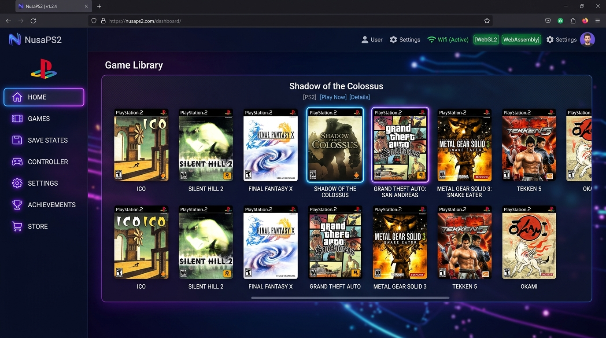
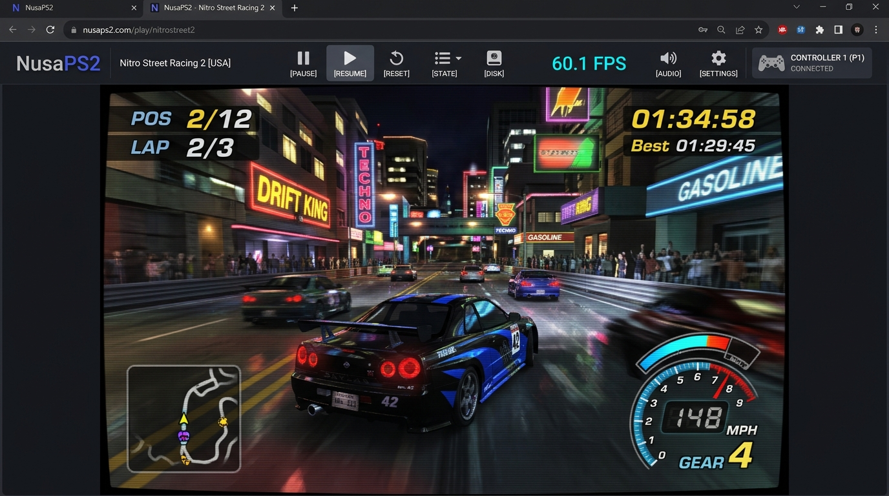

<div align="center">

# 🎮 NusaPS2 — Web-Based PlayStation 2 Emulator

**The High-Performance In-Browser PlayStation 2 Emulator & Console Dashboard**  
_Powered by the Play! WebAssembly Core, WebGL 2.0, Vite & Vanilla JavaScript_

[](https://github.com/tarisusdev/NusaPS2/actions)
[](https://ais-pre-2l6dtqf3lp2mvtklhwu3nu-452188101421.asia-northeast1.run.app)
[](LICENSE)
[](https://webassembly.org/)
[](https://www.khronos.org/webgl/)
[](https://nodejs.org/)
[](CONTRIBUTING.md)

<p align="center">
  <a href="#-overview">Overview</a> •
  <a href="#-screenshots">Screenshots</a> •
  <a href="#-key-features">Key Features</a> •
  <a href="#-technical-architecture">Technical Architecture</a> •
  <a href="#-installation--usage">Installation & Usage</a> •
  <a href="#-supported-formats">Supported Formats</a> •
  <a href="#-contributing">Contributing</a> •
  <a href="#-legal--compliance">Legal</a>
</p>

<p align="center">
  
</p>

---

</div>

## 📸 Screenshots

|                     Console Dashboard & Game Library                     |                      WebAssembly 60 FPS Emulation Viewport                      |
| :----------------------------------------------------------------------: | :-----------------------------------------------------------------------------: |
|  |  |
|       _Dark gaming console interface with PS2 disc library cards_        |    _Hardware WebGL 2.0 rasterization with real-time 60 FPS & CRT scanlines_     |

## 🌟 Overview

**NusaPS2** is a production-grade, open-source PlayStation 2 emulator frontend designed to run directly inside modern web browsers. Built upon the WebAssembly port of the renowned open-source **[Play!](https://purei.org/)** PS2 emulator, NusaPS2 enables real 128-bit Emotion Engine (EE) and Graphics Synthesizer (GS) emulation without requiring native binary downloads, browser extensions, or proprietary BIOS dumps.

By combining **WebAssembly pthreads**, **WebGL 2.0 hardware acceleration**, and an asynchronous **virtual block streaming driver**, NusaPS2 runs multi-gigabyte PS2 DVD ISOs with zero out-of-memory crashes while keeping all game files and save data strictly client-side.

---

## ⚡ Why NusaPS2 Stands Out

| Feature                        | Traditional Web Emulators               | NusaPS2 Implementation                                                   |
| :----------------------------- | :-------------------------------------- | :----------------------------------------------------------------------- |
| **Large ISO Files (1–4.7 GB)** | ❌ Tab crashes from RAM OOM             | ✅ **Streaming Block Device** (`File.slice()`) streams sectors on-demand |
| **BIOS Requirement**           | ❌ Requires proprietary SCPH BIOS dumps | ✅ **Built-in HLE BIOS** (Runs homebrew & games legally out-of-the-box)  |
| **Graphics Pipeline**          | ⚠️ Software/Canvas 2D fallback          | ✅ **Hardware-Accelerated WebGL 2.0** with OffscreenCanvas context       |
| **Controller Support**         | ⚠️ Basic keyboard mapping only          | ✅ **W3C Gamepad API (60Hz)** with real-time DualShock 2 SVG visualizer  |
| **Save Data Persistence**      | ⚠️ Volatile local storage               | ✅ **Dual 8MB MagicGate Memory Cards** (`.bin` / `.ps2`) in IndexedDB    |
| **Client Privacy**             | ❌ Uploads ROMs to remote server        | ✅ **100% Client-Side Sandbox** (Zero server uploads or proxies)         |

---

## ✨ Key Features

- **🚀 Genuine WebAssembly Execution**: Powered by `Play.wasm`, emulating the MIPS R5900 Emotion Engine and Vector Units (VU0/VU1) natively in the browser.
- **💿 Zero-RAM Disc Streaming (`DiscImageDevice`)**: Emscripten block device layer that queries sector chunks via `File.slice()`, keeping browser memory footprint under 150 MB even with 4.5 GB ISOs.
- **🎮 Seamless Controller & Gamepad API Integration**:
  - Auto-detection for DualShock 4, DualSense, Xbox Wireless, and Switch Pro gamepads.
  - Interactive DualShock 2 visualizer showing live button highlights and analog stick coordinate deflection.
  - In-browser keyboard rebinding with persistent `localStorage` saving.
- **💾 Dual Virtual Memory Cards**:
  - Slot 1 (`/work/Memorycards/Memorycard1.bin`) and Slot 2 (`/work/Memorycards/Memorycard2.bin`).
  - Native MagicGate format compatible with PCSX2 and standard `.ps2` / `.bin` files.
  - One-click memory card export, import, and local snapshot backups.
- **📺 Customizable Display & Shader Pipeline**:
  - Aspect ratio toggle: 16:9 (Widescreen), 4:3 (PS2 CRT Standard), and Fill/Stretch.
  - Internal resolution scaling (1x Native 640×448, 2x HD 1280×896, 3x Full HD 1920×1344).
  - Authentic 480i CRT scanline shader overlay and bilinear texture filtering.
- **🔍 Built-in System Diagnostics**: Comprehensive auditor verifying WebAssembly threads, WebGL 2.0 GPU vendor, Cross-Origin Isolation headers, and Gamepad polling rate.

---

## 🛠️ Technical Architecture

NusaPS2 bridges the low-level C++ Emscripten runtime of the Play! emulator to the browser's asynchronous DOM, WebGL2, and Web Audio APIs.

```
┌────────────────────────────────────────────────────────────────────────┐
│                              NusaPS2 UI                                │
│       (Dashboard • Game Library • Controller Panel • Diagnostics)       │
└──────────────────────────────────┬─────────────────────────────────────┘
                                   │
              ┌────────────────────┴─────────────────────┐
              ▼                                          ▼
   ┌───────────────────────┐                  ┌──────────────────────┐
   │ IndexedDB & File API  │                  │   W3C Gamepad API    │
   │ (.ISO / .BIN / .ELF)  │                  │ (60Hz RAF Polling)   │
   └──────────┬────────────┘                  └──────────┬───────────┘
              │ File.slice() on-demand                   │ Synthetic Keyboards
              ▼                                          ▼
   ┌───────────────────────┐                  ┌──────────────────────┐
   │    DiscImageDevice    │                  │    #outputCanvas     │
   │ (Virtual Block Bridge)│                  │ (Event Target DOM)   │
   └──────────┬────────────┘                  └──────────┬───────────┘
              │                                          │
              ▼                                          ▼
   ┌─────────────────────────────────────────────────────────────────┐
   │                  Play! WebAssembly Core                         │
   │  ┌─────────────────────────┐       ┌─────────────────────────┐  │
   │  │   Emotion Engine (EE)   │       │ Graphics Synthesizer(GS)│  │
   │  │ MIPS R5900 + VU0 / VU1  │◄─────►│   WebGL 2.0 Pipeline    │  │
   │  │ WebAssembly Multithread │       │     OffscreenCanvas     │  │
   │  └─────────────────────────┘       └─────────────────────────┘  │
   │  ┌─────────────────────────┐       ┌─────────────────────────┐  │
   │  │  SPU2 WebAudio Synth    │       │     MEMFS Work Dir      │  │
   │  │  Stereo 48kHz Output    │       │ (/work/Memorycards)     │  │
   │  └─────────────────────────┘       └─────────────────────────┘  │
   └─────────────────────────────────────────────────────────────────┘
```

### 1. WebAssembly Multithreading & Cross-Origin Isolation

The Play! core utilizes Emscripten pthreads for multithreaded execution of the Emotion Engine, Vector Units, and Graphics Synthesizer. To enable `SharedArrayBuffer` in modern browsers, the server must supply Cross-Origin Isolation headers:

```http
Cross-Origin-Opener-Policy: same-origin
Cross-Origin-Embedder-Policy: require-corp
```

- **Local Dev Server**: Handled natively by Vite in `vite.config.ts`.
- **Iframe / Embedded Environments**: NusaPS2 registers `coi-serviceworker.js` to ensure isolation is established even when running inside sandboxed previews.

### 2. Streaming Block Device Driver (`DiscImageDevice`)

Standard PS2 DVD disc images range from 1 GB to 4.7 GB. Attempting to buffer an entire ISO into a JavaScript `ArrayBuffer` instantly exceeds browser memory quotas and crashes the tab.

NusaPS2 implements a virtual streaming block device that hooks into the Emscripten optical drive subsystem:

```javascript
export class DiscImageDevice {
  constructor(module) {
    this.module = module;
    this.doneFlag = false;
    this.file = null;
  }

  read(dstPtr, offset, size) {
    this.doneFlag = false;
    // Asynchronously read only the requested disc sector range
    this.file
      .slice(offset, offset + size)
      .arrayBuffer()
      .then((buffer) => {
        if (this.module && this.module.HEAPU8) {
          this.module.HEAPU8.set(new Uint8Array(buffer), dstPtr);
        }
        this.doneFlag = true;
      })
      .catch((err) => {
        console.error('[DiscImageDevice] Read error:', err);
        this.doneFlag = true;
      });
  }

  isDone() {
    return this.doneFlag;
  }
}
```

### 3. Graphics Synthesizer & OffscreenCanvas

The Graphics Synthesizer (GS) output is routed to an `OffscreenCanvas` WebGL 2.0 context (`setupOffscreenCanvas`). Draw commands from the PS2 GS pipeline are translated directly into WebGL2 shaders and rasterized at native 60 FPS.

### 4. Controller Input Pipeline

The Play! WebAssembly core receives input events through keyboard event dispatchers attached to `#outputCanvas`. The `GamepadManager` runs inside a 60Hz `requestAnimationFrame` loop, reading active gamepads via `navigator.getGamepads()`, applying a 35% analog deadzone, and converting button presses and stick coordinates into sub-millisecond keyboard event dispatches.

---

## 💻 Installation & Usage

### Prerequisites

- **Node.js**: v18.0.0 or v20.0.0+
- **Browser**: Modern desktop browser supporting WebGL2 and SharedArrayBuffer (Google Chrome, Microsoft Edge, Brave, or Mozilla Firefox).

### 1. Clone the Repository

```bash
git clone https://github.com/tarisusdev/NusaPS2.git
cd NusaPS2
```

### 2. Install Dependencies

```bash
npm install
```

### 3. Start Local Development Server

```bash
npm run dev
```

Open **[http://localhost:3000](http://localhost:3000)** in your browser.

### 4. Production Build & Preview

```bash
# Compile and bundle production assets to /dist
npm run build

# Preview production build locally
npm run preview
```

### 5. Typecheck & Linting

```bash
npm run lint
```

---

## 📂 Supported Formats

| Format               | Extension      | Description                                  | Status                       |
| :------------------- | :------------- | :------------------------------------------- | :--------------------------- |
| **ISO-9660**         | `.iso`         | Standard PlayStation 2 DVD/CD disc images    | ✅ Supported (Streaming)     |
| **MIPS ELF**         | `.elf`         | PlayStation 2 Homebrew / Executable binaries | ✅ Supported (MEMFS Staging) |
| **Compressed Hunks** | `.chd`         | MAME / Play! Compressed disc archive         | ✅ Supported                 |
| **Raw Disc Tracks**  | `.bin`, `.mdf` | Binary disc image dumps                      | ✅ Supported                 |
| **Compressed ISO**   | `.cso`, `.isz` | Compressed disc images                       | ✅ Supported                 |

> **Pre-packaged Homebrew**: NusaPS2 comes with **wLaunchELF v4.43a** (the open-source PS2 homebrew file manager and memory card browser), ready to launch with one click on the dashboard.

---

## 📁 Project Structure

```
nusaps2/
├── .github/
│   ├── workflows/ci.yml        # GitHub Actions automated lint & build pipeline
│   ├── ISSUE_TEMPLATE/         # Bug report & feature request templates
│   └── PULL_REQUEST_TEMPLATE.md# Pull request contribution template
├── public/
│   ├── coi-serviceworker.js    # Cross-Origin Isolation service worker
│   ├── emulator/
│   │   ├── Play.js             # Play! Emscripten WebAssembly loader
│   │   └── Play.wasm           # Play! 64-bit PS2 Emotion Engine + GS WASM binary
│   └── samples/
│       └── wLaunchELF.elf      # Verified PS2 homebrew executable demo
├── src/
│   ├── app/
│   │   ├── router.js           # Client-side hash routing
│   │   └── state.js            # Reactive store for games, settings, and storage
│   ├── components/
│   │   ├── ControllerPanel.js  # DualShock 2 visualizer & keybinding mapper
│   │   ├── EmulatorPlayer.js   # #outputCanvas viewport, toolbar, and metrics
│   │   ├── GameCard.js         # PS2 disc cards with format tags & quick actions
│   │   ├── GameDetailsModal.js # Binary inspection & metadata editor
│   │   ├── Header.js           # Header with Star on GitHub and system badges
│   │   └── Sidebar.js          # Console navigation and live VM status pill
│   ├── controllers/
│   │   ├── GamepadManager.js   # 60Hz Gamepad API polling loop & event injector
│   │   └── InputMapper.js      # PS2 button mappings & customizable keybindings
│   ├── emulator/
│   │   ├── EmulatorAdapter.js  # Core lifecycle management (boot, pause, reset, stop)
│   │   ├── EmulatorLoader.js   # DiscImageDevice streaming block device loader
│   │   └── emulatorConfig.js   # Aspect ratio, resolution, and core constants
│   ├── pages/
│   │   ├── About.js            # Architecture, credits, and open source links
│   │   ├── Dashboard.js        # Console hero banner & recent games
│   │   ├── Diagnostics.js      # Environment audit, WebGL2 vendor, & event logs
│   │   ├── Emulator.js         # Dedicated gameplay screen
│   │   ├── Library.js          # Drag-and-drop game library with search & filter
│   │   ├── SaveData.js         # Dual 8MB memory cards & backup snapshot manager
│   │   └── Settings.js         # Graphics, audio, and performance configuration
│   ├── storage/
│   │   ├── database.js         # IndexedDB connection wrapper
│   │   ├── gameRepository.js   # Game metadata & file blob storage
│   │   └── saveRepository.js   # Memory card snapshot backups
│   ├── utils/
│   │   ├── fileUtils.js        # Magic byte header inspection & quota detection
│   │   ├── formatUtils.js      # File size, date, and play time formatters
│   │   └── icons.js            # Lucide-style SVG icons
│   ├── main.js                 # Application bootstrap & global event bus
│   └── style.css               # Dark PlayStation dashboard theme with neon accents
├── index.html                  # HTML entry point with gaming typography
├── package.json                # Project dependencies & metadata
├── tsconfig.json               # TypeScript configuration
└── vite.config.ts              # Vite server with COOP/COEP isolation headers
```

---

## 🤝 Contributing

Contributions make the open-source community an amazing place to learn, inspire, and create. Any contributions you make are **greatly appreciated**!

### How to Contribute

1. **Fork the Repository**: Click "Fork" at the top right of the GitHub page.
2. **Clone your Fork**:
   ```bash
   git clone https://github.com/tarisusdev/NusaPS2.git
   cd NusaPS2
   ```
3. **Create a Feature Branch**:
   ```bash
   git checkout -b feat/my-new-feature
   ```
4. **Make Your Changes**: Keep code modular, type-checked, and adhere to Vanilla JS principles.
5. **Verify Your Code**:
   ```bash
   npm run lint
   npm run build
   ```
6. **Commit with Conventional Commits**:
   ```bash
   git commit -m "feat: add CRT aperture grille shader preset"
   ```
7. **Push to Your Branch**:
   ```bash
   git push origin feat/my-new-feature
   ```
8. **Open a Pull Request**: Submit your PR on GitHub against the `main` branch.

Please review [CONTRIBUTING.md](CONTRIBUTING.md) and [CODE_OF_CONDUCT.md](CODE_OF_CONDUCT.md) for full community standards.

---

## 📜 Legal & Compliance

- **No Proprietary BIOS Distributed**: NusaPS2 does not bundle or distribute Sony PlayStation 2 BIOS ROMs. Emulation is powered by the built-in High-Level Emulation (HLE) of the open-source Play! core.
- **User-Supplied Backups**: NusaPS2 is intended strictly for homebrew development and playing legally obtained backups created from optical media you own.
- **Trademarks**: "PlayStation", "PS2", "DualShock", and "MagicGate" are registered trademarks of Sony Interactive Entertainment Inc. NusaPS2 is an independent open-source project and is not affiliated with, endorsed by, or sponsored by Sony.

---

<div align="center">

Crafted with passion for retro computing and WebAssembly by [tarisusdev](https://github.com/tarisusdev) & Contributors.

⭐ **If you find this project exciting, please consider starring it on GitHub!** ⭐

</div>
